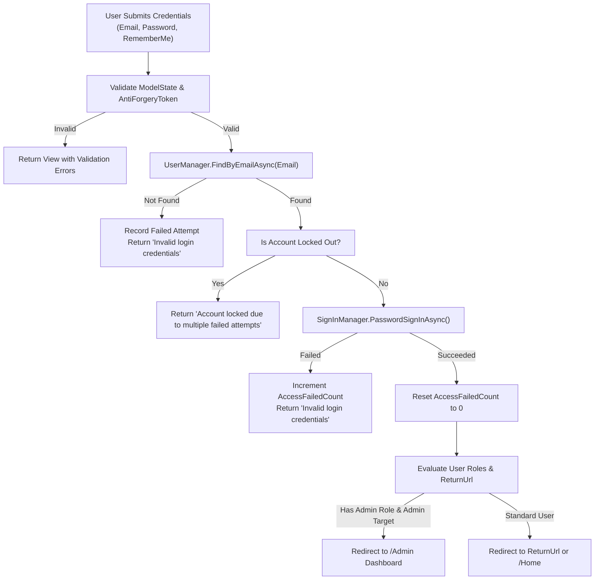
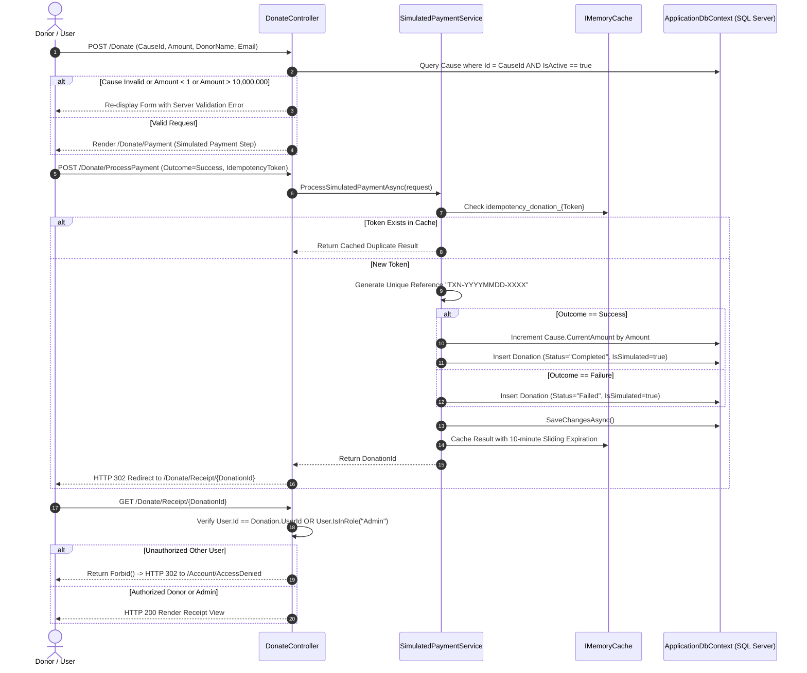

# Give-AID NGO — Algorithms and Program Logic

**Document ID:** `ALG-01`  
**Application Architecture:** ASP.NET Core MVC Monolith (.NET 10.0)  
**Date:** October 2026  

---

## 1. Overview

This document specifies the algorithmic logic, step-by-step processing pipelines, validation rules, and error-handling routines for the core interactive workflows in the Give-AID platform. All logic described here maps directly to active controllers and services in the codebase.

---

## 2. Workflow A: Authentication & Role-Based Authorization

### 2.1 Purpose
Provides secure member onboarding, credential verification with lockout protection, role claim issuance, and access restrictions separating public users from platform administrators.

### 2.2 Algorithm Flowchart



### 2.3 Step-by-Step Processing Pipeline
1. **Input:** `LoginViewModel` (Email, Password, RememberMe, ReturnUrl, `__RequestVerificationToken`).
2. **Anti-CSRF Verification:** `[ValidateAntiForgeryToken]` verifies token against user session cookie.
3. **Form Validation:** Checks non-empty email format and password presence.
4. **Credential Evaluation:** `SignInManager.PasswordSignInAsync(Email, Password, RememberMe, lockoutOnFailure: true)` verifies salted PBKDF2 hash.
5. **Lockout Policy:** After 5 consecutive failed attempts, account access is suspended for 5 minutes (`LockoutEnd`).
6. **Role Assignment upon Registration:** When a new user registers (`AccountController.Register`), the system strictly executes:
   ```csharp
   await _userManager.AddToRoleAsync(user, "User");
   ```
   Under no circumstances can a user self-assign the `Admin` role.
7. **Access Control Enforcement:** Administrative controllers declare `[Authorize(Roles = "Admin")]`. Requests lacking this role claim are challenged by ASP.NET Core Identity, redirecting unauthenticated users to `/Account/Login` and regular users to `/Account/AccessDenied`.
8. **Output:** Authenticated session cookie or error feedback.
9. **Relevant Files:**
   - [`AccountController.cs`](file:///d:/Give-AID%20NGO/GiveAid.Web/Controllers/AccountController.cs)
   - [`LoginViewModel.cs`](file:///d:/Give-AID%20NGO/GiveAid.Web/ViewModels/LoginViewModel.cs)
   - [`RoleSeedService.cs`](file:///d:/Give-AID%20NGO/GiveAid.Web/Services/RoleSeedService.cs)

---

## 3. Workflow B: Simulated Donation Processing & Receipt Generation

### 3.1 Purpose
Enables public visitors and registered members to contribute demo funds to active causes, validating amounts, generating non-sensitive transaction references, updating cause funding totals, generating receipts, and enforcing strict privacy protection.

### 3.2 Algorithm Flowchart



### 3.3 Step-by-Step Processing Pipeline
1. **Input:**
   - Step 1: `DonationFormViewModel` (CauseId, Amount, DonorName, DonorEmail, DonorPhone).
   - Step 2: `SimulatedPaymentViewModel` (CauseId, Amount, DonorName, DonorEmail, IdempotencyToken, SimulatedOutcome: `Success` or `Failure`).
2. **Server-Side Validation:**
   - Amount must be between PKR 1 and PKR 10,000,000 (`Range(1, 10000000)`).
   - Target Cause must exist and `IsActive == true`.
   - Idempotency token prevents double-submission via browser back/refresh.
3. **Reference Generation:** Generated via `GenerateUniqueReferenceAsync()` combining date and cryptographic random bytes:
   ```csharp
   var reference = $"TXN-{DateTime.UtcNow:yyyyMMdd}-{RandomNumberGenerator.GetHexString(4).ToUpper()}";
   ```
4. **Funding Increment:** If `SimulatedOutcome == "Success"`, the target `Cause.CurrentAmount` is increased by the donated amount.
5. **Persistence:** Saved to `Donations` table with `IsSimulated = true`.
6. **Non-Blocking Email Fallback:** Dispatches digital receipt via `IEmailService`. If SMTP is unconfigured, delivery is logged without error.
7. **Privacy Guard:** On `GET /Donate/Receipt/{id}`, the controller evaluates:
   ```csharp
   if (!isAdmin && donation.UserId != currentUserId)
   {
       return Forbid();
   }
   ```
   Unauthorized users receive HTTP 302 redirecting to `AccessDenied`.
8. **Relevant Files:**
   - [`DonateController.cs`](file:///d:/Give-AID%20NGO/GiveAid.Web/Controllers/DonateController.cs)
   - [`SimulatedPaymentService.cs`](file:///d:/Give-AID%20NGO/GiveAid.Web/Services/SimulatedPaymentService.cs)
   - [`Donation.cs`](file:///d:/Give-AID%20NGO/GiveAid.Web/Models/Donation.cs)

---

## 4. Workflow C: Contact Query Resolution & Administrative Reply

### 4.1 Purpose
Collects public inquiries, associates inquiries with registered member profiles, supports administrative status management, and records official coordination responses.

### 4.2 Algorithm Steps
1. **Inquiry Submission (`POST /Contact`):**
   - Inputs: `Name`, `Email`, `Phone`, `Subject`, `Message`.
   - Server-side validation: String lengths, required fields, email format.
   - Profile Linking: If `User.Identity.IsAuthenticated == true`, `ContactQuery.UserId` is automatically bound from claims.
   - Status initialized to `New`.
   - Saved to `ContactQueries` table.
2. **Administrative Management (`/Admin/Queries`):**
   - Admin views list filtered by status (`All`, `New`, `In Progress`, `Answered`, `Closed`).
   - Admin opens `GET /Admin/Queries/Details/{id}` to view full message and history.
3. **Official Reply Submission (`POST /Admin/Queries/Reply/{id}`):**
   - Input: `AdminReply`, `AdminNotes`, `SendEmailNotification` flag.
   - Verification: Query exists; reply message is non-empty.
   - Updates `ContactQuery.Status = "Answered"`, `ContactQuery.RepliedAt = DateTime.UtcNow`, and saves notes.
   - Dispatches email notification via `IEmailService` (or logs simulation).
4. **Relevant Files:**
   - [`ContactController.cs`](file:///d:/Give-AID%20NGO/GiveAid.Web/Controllers/ContactController.cs)
   - [`AdminQueriesController.cs`](file:///d:/Give-AID%20NGO/GiveAid.Web/Controllers/AdminQueriesController.cs)
   - [`ContactQuery.cs`](file:///d:/Give-AID%20NGO/GiveAid.Web/Models/ContactQuery.cs)

---

## 5. Workflow D: Defensive File Upload Pipeline

### 5.1 Purpose
Guarantees that uploaded media assets (NGO logos, partner sponsors, programme banners, gallery images) are safe, genuine image files and free from path-traversal vulnerabilities.

### 5.2 Algorithmic Verification Steps
```text
1. Receive IFormFile from multipart/form-data request.
2. Check File Length:
   IF Length == 0 OR Length > 5,242,880 (5 MB) -> REJECT with size error.
3. Extension Whitelist Check:
   Extract extension via Path.GetExtension(file.FileName).ToLowerInvariant().
   IF extension NOT IN [".jpg", ".jpeg", ".png", ".webp"] -> REJECT format.
4. Magic Byte (MIME Signature) Inspection:
   Read first 8 bytes of file stream.
   Compare against known binary signatures:
   - JPEG:  FF D8 FF
   - PNG:   89 50 4E 47 0D 0A 1A 0A
   - WEBP:  52 49 46 46 (RIFF header)
   IF signature does not match expected bytes -> REJECT genuine image check.
5. Filename Sanitization:
   Generate unique, non-reversible filename: $"{Guid.NewGuid():N}{extension}".
   NEVER use the user-supplied filename on disk.
6. Target Directory Resolution:
   Path.Combine(WebRootPath, "uploads", subfolder).
   Directory.CreateDirectory() ensures folder exists.
7. Save File:
   Stream file asynchronously to target disk path.
8. Return Relative Web Path:
   Return "/uploads/{subfolder}/{safeFileName}" for database storage.
```

### 5.3 Path-Traversal Guard on Deletion
When deleting an image, `ImageUploadService.DeleteImage` checks:
- Path must begin with `/uploads/`.
- Path must not contain `..` or `\` directory traversal characters.
- File existence verified before deletion.

### 5.4 Relevant Files:
- [`ImageUploadService.cs`](file:///d:/Give-AID%20NGO/GiveAid.Web/Services/ImageUploadService.cs)
- [`AdminNgosController.cs`](file:///d:/Give-AID%20NGO/GiveAid.Web/Controllers/AdminNgosController.cs)
- [`AdminGalleryController.cs`](file:///d:/Give-AID%20NGO/GiveAid.Web/Controllers/AdminGalleryController.cs)

---

## 6. Workflow E: Programme Participation & Volunteer Intake

### 6.1 Purpose
Facilitates volunteer recruitment and community participant registration for scheduled welfare drives, prevents duplicate submissions, and provides applicant tracking.

### 6.2 Algorithmic Steps
1. **Initiation (`GET /Programmes/ExpressInterest?programmeId={id}`):**
   - Verifies programme exists in database.
   - If authenticated, pre-fills applicant name, email, and phone from user claims.
   - Checks if user has already submitted; if so, displays notice of current status.
2. **Submission (`POST /Programmes/ExpressInterest`):**
   - Validates role: `InterestType` must be `"Volunteer"` or `"Participant"`.
   - **Duplicate Guard:** Queries `ProgrammeInterests` for existing application with matching `ProgrammeId` and `ApplicantEmail`:
     ```csharp
     var isDuplicate = await _context.ProgrammeInterests
         .AnyAsync(pi => pi.ProgrammeId == model.ProgrammeId && pi.ApplicantEmail.ToLower() == model.ApplicantEmail.ToLower());
     ```
     If duplicate exists, adds model error: *"An interest application for this programme with this email address has already been submitted."*
   - Persists entity to database with `Status = "Pending"`.
   - Confirmation email notification dispatched via `IEmailService`.
   - Redirects authenticated users to personal history at `/Programmes/MyInterests`.
3. **Administrative Review (`/Admin/Interests`):**
   - Admin filters applications by programme and status (`Pending`, `Approved`, `Rejected`).
   - Admin updates application status and records optional internal review notes.
4. **Relevant Files:**
   - [`ProgrammesController.cs`](file:///d:/Give-AID%20NGO/GiveAid.Web/Controllers/ProgrammesController.cs)
   - [`AdminInterestsController.cs`](file:///d:/Give-AID%20NGO/GiveAid.Web/Controllers/AdminInterestsController.cs)
   - [`ProgrammeInterest.cs`](file:///d:/Give-AID%20NGO/GiveAid.Web/Models/ProgrammeInterest.cs)
