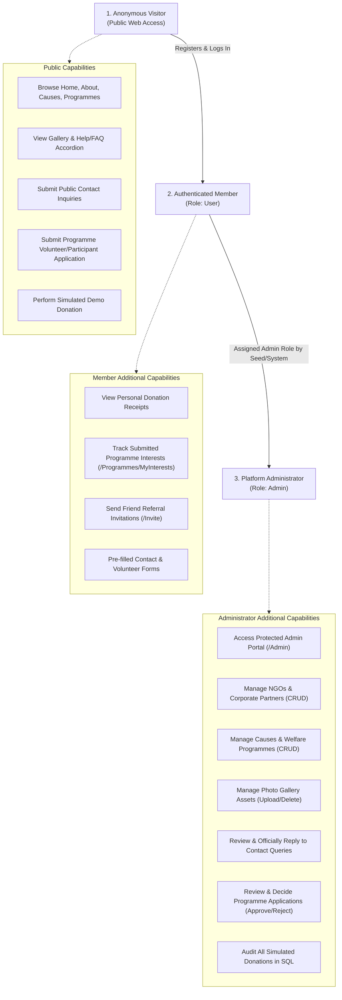

# Give-AID NGO — Customer Requirement Specification (CRS)

**Document ID:** `CRS-01`  
**Project Name:** Give-AID Humanitarian Web Platform  
**Target Domain:** Non-Governmental Organization (NGO) & Charity Portal  
**Platform:** ASP.NET Core MVC (.NET 10), C#, Entity Framework Core, SQL Server Express  
**Document Version:** 1.0 (Final Verification)  
**Date:** October 2026  

---

## 1. Introduction and Purpose
This Customer Requirement Specification (CRS) defines the business, functional, and non-functional requirements for the Give-AID web platform. It establishes the baseline against which the completed system was built, tested, and verified during Tasks 01–18 of the project roadmap.

Give-AID serves as a unified digital ecosystem for non-profit operations, community engagement, volunteer recruitment, and transparent donation tracking.

---

## 2. User Roles and Stakeholder Hierarchy

The application enforces three distinct user access tiers:

### 2.1 Anonymous Visitor
- Public visitors can freely access all informational pages: Home (`/`), About Us (`/Home/About`), Active Causes (`/Causes`), Corporate Partners (`/Partners`), Welfare Programmes (`/Programmes`), Field Gallery (`/Gallery`), Help/FAQ Centre (`/Help`), and Contact Us (`/Contact`).
- May initiate simulated donations as a guest and receive a transaction receipt.
- May apply to volunteer or participate in scheduled programmes.
- May submit general contact inquiries.
- **Restrictions:** Cannot view other users' donation histories, cannot access `/Admin`, and cannot perform administrative CRUD operations.

### 2.2 Authenticated Member (`User` Role)
- Inherits all public visitor capabilities.
- Receives auto-populated forms (name, email, phone) on donation, contact, and volunteer pages.
- Access to private donation receipt history and individual receipts.
- Access to personal programme application tracking at `/Programmes/MyInterests`.
- Access to the friend referral workflow at `/Invite`.
- **Restrictions:** Strictly blocked from `/Admin` routes via `[Authorize(Roles = "Admin")]`. Any unauthorized access attempt triggers an automatic HTTP 302 redirect to `/Account/AccessDenied`.

### 2.3 Platform Administrator (`Admin` Role)
- Authorized via role claim evaluation.
- Full access to the `/Admin` portal featuring real-time statistical KPI cards.
- Complete CRUD capabilities over NGOs, Partners, Causes, Programmes, and Gallery images.
- Inspection and resolution of Contact Queries (updating status to `In Progress`, `Answered`, or `Closed`, and logging official replies).
- Review and status assignment for Programme Interest applications (`Pending`, `Approved`, `Rejected`).
- Full read access to all platform donation records for financial audit verification.

---

## 3. Functional Requirements Catalog

The table below outlines all functional requirements, their mapped user roles, and their verified implementation status in the delivered system:

| Req ID | Module / Feature | Detailed Description | Target Role | Implementation Status |
| :--- | :--- | :--- | :--- | :--- |
| **FR-001** | Public Layout | Hero banner with call-to-action linking to demo donation workflow. | Public | **Implemented & Verified** |
| **FR-002** | Home Page | Featured causes showcase with dynamic target vs. raised progress bars. | Public | **Implemented & Verified** |
| **FR-003** | Home Page | Summary of upcoming scheduled welfare drives. | Public | **Implemented & Verified** |
| **FR-004** | Home Page | Verified impact summary metrics and counter cards. | Public | **Implemented & Verified** |
| **FR-005** | Home Page | Display of approved corporate sponsor and partner logos. | Public | **Implemented & Verified** |
| **FR-006** | Global Nav | Persistent header, navigation links, and footer with copyright and disclaimers. | Public | **Implemented & Verified** |
| **FR-007** | About Us | What We Do narrative detailing social focus sectors. | Public | **Implemented & Verified** |
| **FR-008** | About Us | Official mission statement, core guiding values, and organizational vision. | Public | **Implemented & Verified** |
| **FR-009** | About Us | Profiles of leadership, trustees, and operational coordinators. | Public | **Implemented & Verified** |
| **FR-010** | About Us | Career and volunteer opportunities recruitment notice. | Public | **Implemented & Verified** |
| **FR-011** | About Us | Organizational milestones, awards, and historical completions. | Public | **Implemented & Verified** |
| **FR-012** | About Us | Major institutional supporters and patron foundation roster. | Public | **Implemented & Verified** |
| **FR-013** | About Us | Extended background reading, reports, and press mentions. | Public | **Implemented & Verified** |
| **FR-014** | About Us | Database entity `AboutSection` with keys to support content updates. | Admin | **Implemented & Verified** |
| **FR-015** | Causes | Public causes catalog with category filtering and visual thumbnails. | Public | **Implemented & Verified** |
| **FR-016** | Causes | Cause detail page showing detailed narrative, organizing NGO, and target. | Public | **Implemented & Verified** |
| **FR-017** | Causes | Graceful empty-state banners when zero causes match active criteria. | Public | **Implemented & Verified** |
| **FR-018** | Causes CRUD | Administrative Create, Read, Update, Delete for charitable causes. | Admin | **Implemented & Verified** |
| **FR-019** | File Uploads | Extension and magic byte validation for campaign and banner images. | Admin | **Implemented & Verified** |
| **FR-020** | Donation UI | Dedicated multi-step donation page with preset amounts and custom input. | Public / Member | **Implemented & Verified** |
| **FR-021** | Donation Limits | Server-side validation enforcing donation amounts between PKR 1 and PKR 10M. | Public / Member | **Implemented & Verified** |
| **FR-022** | Donation Demo | Prominent banner clearly declaring demo nature; real cards never collected. | Public / Member | **Implemented & Verified** |
| **FR-023** | Donation Flow | Two-step demo checkout: (1) Selection, (2) Simulated Payment Step. | Public / Member | **Implemented & Verified** |
| **FR-024** | Demo Outcomes | Deterministic outcome selection ("Simulate Success" vs. "Simulate Failure"). | Public / Member | **Implemented & Verified** |
| **FR-025** | Reference Gen | Automated non-sensitive alphanumeric reference generation (`TXN-YYYYMMDD-XXXX`). | System | **Implemented & Verified** |
| **FR-026** | Audit Storage | Immutable persistence to `Donations` table with status and UTC timestamp. | System | **Implemented & Verified** |
| **FR-027** | Digital Receipt | Formatted printable confirmation receipt displaying reference and cause. | Public / Member | **Implemented & Verified** |
| **FR-028** | Privacy Guard | Strict privacy check: only the donor or an Admin may view receipt records. | System | **Implemented & Verified** |
| **FR-029** | Cause Increment | Successful simulated donation increments `Cause.CurrentAmount` in SQL. | System | **Implemented & Verified** |
| **FR-030** | NGO Directory | Public directory of accredited non-governmental organizations. | Public | **Implemented & Verified** |
| **FR-031** | NGO CRUD | Administrative management of affiliated NGOs with logo uploads. | Admin | **Implemented & Verified** |
| **FR-032** | Partner Roster | Public showcase of corporate sponsors with display ordering. | Public | **Implemented & Verified** |
| **FR-033** | Partner CRUD | Administrative management of corporate partners and sponsor types. | Admin | **Implemented & Verified** |
| **FR-034** | Programme List | Public event calendar filtering upcoming scheduled vs. past completed drives. | Public | **Implemented & Verified** |
| **FR-035** | Programme View | Detailed event page with dates, venue location, and coordinator contacts. | Public | **Implemented & Verified** |
| **FR-036** | Programme CRUD | Administrative scheduling, updating, and cancellation of programmes. | Admin | **Implemented & Verified** |
| **FR-037** | Photo Gallery | WCAG-compliant photo grid with mandatory alternative text. | Public | **Implemented & Verified** |
| **FR-038** | Volunteer Intake | Expression of interest application form for upcoming programmes. | Public / Member | **Implemented & Verified** |
| **FR-039** | Duplicate Guard | Server-side rejection of duplicate volunteer applications for same email/event. | System | **Implemented & Verified** |
| **FR-040** | User History | Member self-service view of past applications at `/Programmes/MyInterests`. | Member | **Implemented & Verified** |
| **FR-041** | Admin Intake | Admin review interface to assign statuses (`Pending`, `Approved`, `Rejected`). | Admin | **Implemented & Verified** |
| **FR-042** | Identity Reg | User registration with automatic assignment of `User` role. | Public | **Implemented & Verified** |
| **FR-043** | Identity Login | Secure authentication with password hashing and lockout on repeated failures. | Public | **Implemented & Verified** |
| **FR-044** | Role Seeding | Idempotent startup seeder for `Admin` and `User` roles and default admin. | System | **Implemented & Verified** |
| **FR-045** | Escalation Guard | Client-side or browser-side self-elevation to `Admin` strictly impossible. | System | **Implemented & Verified** |
| **FR-046** | Help & FAQ | Categorized accordion interface answering common donor and volunteer queries. | Public | **Implemented & Verified** |
| **FR-047** | Contact Form | Public inquiry submission capturing sender name, email, phone, subject, message. | Public / Member | **Implemented & Verified** |
| **FR-048** | Contact Profile | Automatic association of contact inquiry with logged-in user ID. | Member | **Implemented & Verified** |
| **FR-049** | Admin Queries | Administrative query dashboard with resolution status filters. | Admin | **Implemented & Verified** |
| **FR-050** | Admin Reply | Administrative recording of internal notes and official inquiry replies. | Admin | **Implemented & Verified** |
| **FR-051** | Email Service | Configurable SMTP abstraction with safe logging fallback when unconfigured. | System | **Implemented & Verified** |
| **FR-052** | Referral System | Authenticated friend email invitations logged to `Invitations` table. | Member | **Implemented & Verified** |
| **FR-053** | Admin Dashboard | Centralized administrative portal with 9 real-time KPI metrics. | Admin | **Implemented & Verified** |
| **FR-054** | Defensive Token | Anti-CSRF verification on all POST endpoints via `[AutoValidateAntiforgeryToken]`.| System | **Implemented & Verified** |
| **FR-055** | Security Headers | Strict response headers (`nosniff`, `SAMEORIGIN`, `1; mode=block`). | System | **Implemented & Verified** |
| **FR-056** | Friendly Errors | Branded, non-revealing error page handling 404/403/500 codes. | Public | **Implemented & Verified** |

---

## 4. Non-Functional Requirements (NFR)

### 4.1 Security (NFR-SEC)
- **Authentication & Hashes:** ASP.NET Core Identity uses PBKDF2 with HMAC-SHA256 and high iteration counts for password hashing.
- **CSRF Defense:** Application-wide `AutoValidateAntiforgeryTokenAttribute` protects all state-altering POST requests.
- **Header Hardening:** Custom middleware in `Program.cs` injects `X-Content-Type-Options: nosniff`, `X-Frame-Options: SAMEORIGIN`, and `X-XSS-Protection: 1; mode=block`.
- **Payment Safety:** Real credit card credentials, CVVs, and banking PINs are never accepted or stored.
- **Upload Defense:** Uploads in `ImageUploadService` undergo strict whitelist extension checks (`.jpg`, `.jpeg`, `.png`, `.webp`), magic byte inspection, 5 MB file size caps, and filename sanitization with `Guid.NewGuid()`.

### 4.2 Performance & Scalability (NFR-PRF)
- **Database Indexing:** Unique indexes on `Donations.TransactionReference`, `AboutSections.SectionKey`, composite index on `ProgrammeInterests(ProgrammeId, ApplicantEmail)`, and index on `Donations.UserId`.
- **Read-Only Optimizations:** Non-modifying queries utilize `.AsNoTracking()` to reduce EF Core change-tracker overhead.
- **Asset Caching:** Static stylesheets, scripts, and images in `wwwroot/` are served with caching headers.

### 4.3 Usability & Responsive Design (NFR-USE)
- **Mobile Responsiveness:** Viewports adapt seamlessly across mobile (320px–480px), tablet (768px–1024px), and desktop (1200px+) using Bootstrap 5 fluid grid containers.
- **Visual Design System:** Standardized CSS custom properties in `site.css` and `admin.css` guarantee cohesive typography, borders, shadows, and color palettes.
- **Informative Empty States:** Tables and catalogs display polite empty-state indicators with action buttons when records are absent.

### 4.4 Accessibility (NFR-ACC)
- **Semantic HTML5:** Native landmark elements (`<header>`, `<nav>`, `<main>`, `<section>`, `<footer>`) are used throughout.
- **Screen Reader Support:** Skip-to-main-content link (`.skip-link`) provided on all layouts.
- **Color Contrast:** Deep Teal (`#0f766e`) on white exceeds WCAG AA contrast ratio of 4.5:1.
- **Mandatory Alt Text:** `GalleryImage.AltText` is required on creation to ensure assistive technologies can describe field photographs.

### 4.5 Reliability & Fault Tolerance (NFR-REL)
- **Database Consistency:** Financial decimal values enforce precision `(18,2)`. Foreign keys use `DeleteBehavior.Restrict` on causes and donations to prevent accidental audit record deletion.
- **Email Delivery Resiliency:** Email service automatically detects unconfigured SMTP credentials and simulates delivery via structured console logging without throwing runtime exceptions.
- **Status Code Re-Execution:** Unhandled route errors (404, 403, 500) are intercepted by `UseStatusCodePagesWithReExecute("/Home/Error", "?statusCode={0}")` and rendered using branded views without technical stack trace leakage.

---

## 5. System Constraints and Dependencies

1. **Hosting Environment:** Windows Server / Windows 10/11 running .NET 10.0 Runtime.
2. **Database System:** Microsoft SQL Server Express 2019/2022 (`Server=.\SQLEXPRESS;Database=GiveAidDb`).
3. **Browser Compatibility:** Modern evergreen browsers supporting HTML5, CSS3, and ES6 (Edge, Chrome, Firefox, Safari).
4. **Third-Party Integrations:** Commercial payment gateways (Stripe/PayPal) and live SMS gateways are omitted by design in favor of secure, deterministic simulations.
