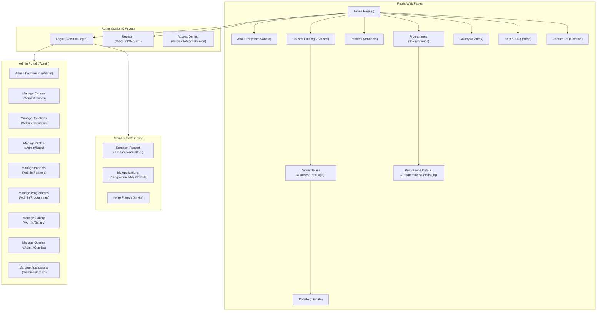

# Give-AID NGO — Interface Design & Page Inventory

**Document ID:** `UI-01`  
**Application:** Give-AID Humanitarian Web Platform  
**Architecture:** Razor Views (`.cshtml`), ASP.NET Core MVC  
**Date:** October 2026  

---

## 1. Overview of Application Interfaces

The user interface of Give-AID is organized into four distinct functional tiers:
1. **Public Web Interfaces:** Freely accessible pages for visitors, potential donors, and community members.
2. **Authentication Interfaces:** Member registration, login, and access restriction pages.
3. **Member Self-Service Interfaces:** Personal donation history, volunteer application tracking, and friend referral forms.
4. **Administrative Portal Interfaces:** High-privilege management interfaces protected by `[Authorize(Roles = "Admin")]` with a dedicated layout (`_AdminLayout.cshtml`).

---

## 2. Page Hierarchy & Navigation Map

---

## 3. Detailed Page Directory & Functional Purpose

### 3.1 Public Portal Pages

#### 1. Home Page (`/` or `/Home/Index`)
- **Controller/Action:** `HomeController.Index` | **View:** `Views/Home/Index.cshtml`
- **Purpose:** Primary public landing page establishing institutional credibility, displaying the hero banner, impact counters, featured campaigns, upcoming welfare drives, and partner logos.
- **Key Elements:** Hero CTA button, 4 impact metric cards, featured cause progress indicators, newsletter/referral teaser.

#### 2. About Us (`/Home/About`)
- **Controller/Action:** `HomeController.About` | **View:** `Views/Home/About.cshtml`
- **Purpose:** Comprehensive organizational disclosure presenting 7 structured narrative sections (What We Do, Mission & Vision, Our Team, Careers, Achievements, Supporters, and Background History).
- **Key Elements:** Sub-navigation jump pills, leadership profile cards, milestone timelines.

#### 3. Causes Catalog (`/Causes`)
- **Controller/Action:** `CausesController.Index` | **View:** `Views/Causes/Index.cshtml`
- **Purpose:** Public catalog of verified active fundraising appeals.
- **Key Elements:** Campaign card grid, visual funding progress bars, target vs. raised amounts, organizing NGO badge, "Donate Now" buttons.

#### 4. Cause Details (`/Causes/Details/{id}`)
- **Controller/Action:** `CausesController.Details` | **View:** `Views/Causes/Details.cshtml`
- **Purpose:** In-depth campaign narrative allowing visitors to read the full context, see organizing NGO credentials, and access a pre-filled donation widget.
- **Key Elements:** Large campaign image, narrative text, progress statistics widget, organizing NGO contact details.

#### 5. Corporate Partners (`/Partners`)
- **Controller/Action:** `PartnersController.Index` | **View:** `Views/Partners/Index.cshtml`
- **Purpose:** Roster of corporate sponsors, technology donors, and supporting institutions.
- **Key Elements:** Partner logo cards, sponsor category badges (e.g., `Technology Sponsor`), display ordering, links to corporate websites.

#### 6. Welfare Programmes (`/Programmes`)
- **Controller/Action:** `ProgrammesController.Index` | **View:** `Views/Programmes/Index.cshtml`
- **Purpose:** Chronological calendar separating upcoming scheduled field camps from past completed humanitarian initiatives.
- **Key Elements:** Date badges, venue location icons, lead coordinator names, "Express Interest" action buttons.

#### 7. Photo Gallery (`/Gallery`)
- **Controller/Action:** `GalleryController.Index` | **View:** `Views/Gallery/Index.cshtml`
- **Purpose:** Visual impact documentation showcasing verified fieldwork photographs.
- **Key Elements:** Filterable grid layout, image lightbox trigger, mandatory accessibility alt text.

#### 8. Help Centre & FAQ (`/Help`)
- **Controller/Action:** `HelpController.Index` | **View:** `Views/Help/Index.cshtml`
- **Purpose:** Self-service knowledge base resolving visitor questions regarding donation safety, tax exemptions, and volunteering.
- **Key Elements:** Accordion panels categorized by topic, search filter, direct contact teaser.

#### 9. Contact Us (`/Contact`)
- **Controller/Action:** `ContactController.Index` | **View:** `Views/Contact/Index.cshtml`
- **Purpose:** Public inquiry submission form with auto-fill capabilities for logged-in users.
- **Key Elements:** Full name, email, phone, subject, message textarea, anti-CSRF token, office location cards.

---

### 3.2 Authentication Pages

#### 10. Member Login (`/Account/Login`)
- **Controller/Action:** `AccountController.Login` | **View:** `Views/Account/Login.cshtml`
- **Purpose:** Credential entry for registered members and administrators.
- **Key Elements:** Email, password input, Remember Me toggle, validation error summary, links to Register.

#### 11. Member Registration (`/Account/Register`)
- **Controller/Action:** `AccountController.Register` | **View:** `Views/Account/Register.cshtml`
- **Purpose:** Onboarding form for new community members.
- **Key Elements:** Full name, email, password, confirm password, client and server validation.

#### 12. Access Denied (`/Account/AccessDenied`)
- **Controller/Action:** `AccountController.AccessDenied` | **View:** `Views/Account/AccessDenied.cshtml`
- **Purpose:** Friendly authorization boundary informing unauthorized users that administrative privileges are required.
- **Key Elements:** Security shield illustration, return to Home button, return to Login button.

---

### 3.3 Member Self-Service Pages

#### 13. Public / Member Donation Workflow (`/Donate` & `/Donate/Payment`)
- **Controller/Action:** `DonateController.Index` & `DonateController.ProcessPayment` | **Views:** `Views/Donate/Index.cshtml` & `Views/Donate/Payment.cshtml`
- **Purpose:** Two-step educational demo checkout: (1) Cause and amount selection, (2) Simulated payment outcome execution.
- **Key Elements:** Preset amount buttons (PKR 1,000 to PKR 25,000), custom amount input, prominent demo notice banner, deterministic outcome radio options.

#### 14. Donation Receipt (`/Donate/Receipt/{id}`)
- **Controller/Action:** `DonateController.Receipt` | **View:** `Views/Donate/Receipt.cshtml`
- **Purpose:** Formatted printable transaction receipt displaying unique reference (`TXN-`), cause, amount, and donor name. Protected by strict cross-user privacy logic.
- **Key Elements:** Verification checkmark, printable receipt container, Print Receipt button.

#### 15. Programme Express Interest (`/Programmes/ExpressInterest?programmeId={id}`)
- **Controller/Action:** `ProgrammesController.ExpressInterest` | **View:** `Views/Programmes/ExpressInterest.cshtml`
- **Purpose:** Intake form for volunteering or participating in a specific welfare drive.
- **Key Elements:** Contextual event summary, applicant contact details, role selection (`Volunteer` / `Participant`), experience message.

#### 16. My Applications History (`/Programmes/MyInterests`)
- **Controller/Action:** `ProgrammesController.MyInterests` | **View:** `Views/Programmes/MyInterests.cshtml`
- **Purpose:** Authenticated member dashboard showing all personal volunteer applications.
- **Key Elements:** Application cards displaying event date, role, submission timestamp, and current review status (`Pending`, `Approved`, `Rejected`).

#### 17. Invite Friends (`/Invite`)
- **Controller/Action:** `InviteController.Index` | **View:** `Views/Invite/Index.cshtml`
- **Purpose:** Member referral tool allowing users to invite colleagues to support Give-AID.
- **Key Elements:** Friend email input, optional personalized message, submit button.

---

### 3.4 Administrative Portal Pages

#### 18. Admin Dashboard (`/Admin`)
- **Controller/Action:** `AdminController.Index` | **View:** `Views/Admin/Index.cshtml`
- **Purpose:** Central operational landing page for system administrators.
- **Key Elements:** 9 KPI metric cards (Causes, Donations, Members, NGOs, Partners, Programmes, Gallery Photos, Queries, Pending Applications), quick links, recent activity feeds.

#### 19. Manage NGOs (`/Admin/Ngos`)
- **Controller/Action:** `AdminNgosController.Index` | **Views:** `Views/Admin/Ngos/Index.cshtml`, `Create.cshtml`, `Edit.cshtml`, `Details.cshtml`, `Delete.cshtml`
- **Purpose:** Comprehensive CRUD management of accredited partner NGOs.
- **Key Elements:** Logo thumbnail, registration number, active switch, modal delete confirmation.

#### 20. Manage Corporate Partners (`/Admin/Partners`)
- **Controller/Action:** `AdminPartnersController.Index` | **Views:** `Views/Admin/Partners/Index.cshtml`, `Create.cshtml`, `Edit.cshtml`, `Details.cshtml`, `Delete.cshtml`
- **Purpose:** Management of corporate sponsors and supporting institutions.
- **Key Elements:** Logo preview, partner category selector, display order weights.

#### 21. Manage Programmes (`/Admin/Programmes`)
- **Controller/Action:** `AdminProgrammesController.Index` | **Views:** `Views/Admin/Programmes/...`
- **Purpose:** Event scheduling, location management, and status updates for community welfare initiatives.
- **Key Elements:** Date pickers, venue inputs, coordinator contact fields.

#### 22. Manage Inquiries (`/Admin/Queries`)
- **Controller/Action:** `AdminQueriesController.Index` | **Views:** `Views/Admin/Queries/Index.cshtml` & `Details.cshtml`
- **Purpose:** Reviewing public contact inquiries and recording official administrative replies.
- **Key Elements:** Status filters (`New`, `In Progress`, `Answered`, `Closed`), internal notes editor, official reply form.

#### 23. Manage Programme Applications (`/Admin/Interests`)
- **Controller/Action:** `AdminInterestsController.Index` | **Views:** `Views/Admin/Interests/...`
- **Purpose:** Reviewing volunteer and participant submissions.
- **Key Elements:** Programme filter, applicant details modal, status decision buttons (`Approve`, `Reject`).

---

## 4. Screenshot Inventory & Capture Guide

To document visual compliance in academic submissions, capture genuine full-page screenshots of the running application at `http://localhost:5187` using standard browser developer tools (or full-page screenshot extensions) and store them in the `docs/screenshots/` directory using the naming convention below:

| Screenshot ID | Page Name | Recommended Relative Path | Suggested Dimensions | Verification Focus |
| :--- | :--- | :--- | :--- | :--- |
| `SCR-01` | Public Home Page | `docs/screenshots/01-home-page.png` | 1440 × 900 | Hero section, impact statistics, featured campaigns |
| `SCR-02` | About Us Narrative | `docs/screenshots/02-about-us.png` | 1440 × 900 | 7 structured content areas, leadership cards |
| `SCR-03` | Causes Catalog | `docs/screenshots/03-causes-catalog.png` | 1440 × 900 | Grid of campaign cards, dynamic progress bars |
| `SCR-04` | Cause Details View | `docs/screenshots/04-cause-details.png` | 1440 × 900 | Campaign narrative, organizing NGO card, donate CTA |
| `SCR-05` | Simulated Donation Step 1 | `docs/screenshots/05-donate-form.png` | 1440 × 900 | Preset amount pills, custom amount input, notice banner |
| `SCR-06` | Simulated Payment Step 2 | `docs/screenshots/06-donate-payment.png` | 1440 × 900 | Deterministic outcome toggles (Simulate Success) |
| `SCR-07` | Donor Digital Receipt | `docs/screenshots/07-donation-receipt.png` | 1440 × 900 | Formatted receipt container, unique `TXN-` reference |
| `SCR-08` | Welfare Programmes | `docs/screenshots/08-programmes.png` | 1440 × 900 | Upcoming vs. past event tabs, venue locations |
| `SCR-09` | Express Interest Form | `docs/screenshots/09-express-interest.png` | 1440 × 900 | Role selector (`Volunteer`/`Participant`), event summary |
| `SCR-10` | User My Applications | `docs/screenshots/10-my-applications.png` | 1440 × 900 | Status badges (`Pending`, `Approved`) for applications |
| `SCR-11` | Field Photo Gallery | `docs/screenshots/11-gallery.png` | 1440 × 900 | Filterable photo grid with accessible alt descriptions |
| `SCR-12` | Help Centre FAQ | `docs/screenshots/12-help-faq.png` | 1440 × 900 | Expanded accordion panel answering donor questions |
| `SCR-13` | Public Contact Form | `docs/screenshots/13-contact-us.png` | 1440 × 900 | Inquiry inputs, anti-forgery validation |
| `SCR-14` | Member Login Page | `docs/screenshots/14-member-login.png` | 1440 × 900 | Floating labels, Remember Me checkbox |
| `SCR-15` | Admin Dashboard Overview | `docs/screenshots/15-admin-dashboard.png` | 1440 × 900 | 9 real-time KPI cards, isolated dark sidebar |
| `SCR-16` | Admin NGO Management | `docs/screenshots/16-admin-ngos.png` | 1440 × 900 | Table with logos, status pills, action buttons |
| `SCR-17` | Admin Query Reply View | `docs/screenshots/17-admin-query-reply.png`| 1440 × 900 | Inquirer details, internal notes, official reply textarea |
| `SCR-18` | Access Denied Screen | `docs/screenshots/18-access-denied.png` | 1440 × 900 | Shield illustration, 403 authorization message |

> **Note on Screenshot Evidence:** The paths above establish the official destination directory and filenames for image evidence. To maintain academic and documentation integrity, genuine screenshots captured from the running application must be placed in `docs/screenshots/`.
