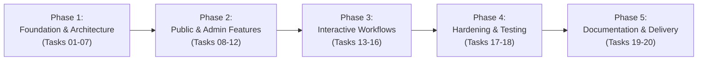

# Give-AID NGO — Project Plan and Task Documentation

**Project Name:** Give-AID Humanitarian Web Platform  
**Document ID:** `PLAN-01`  
**Methodology:** Phased Iterative Waterfall with Verification Gates  
**Architecture:** ASP.NET Core MVC Monolith (.NET 10.0)  
**Date:** October 2026  

---

## 1. Project Overview

The Give-AID project was structured to deliver an enterprise-grade non-governmental organization web portal. The project lifecycle spans requirement definition, environment configuration, database architecture, design system engineering, authentication and authorization, core public and administrative features, security hardening, automated end-to-end regression testing, and academic project documentation.

---

## 2. Development Phases & Task Sequence

### Phase 1: Foundation, Environment & Core Setup (Tasks 01–07)
Focus: Requirement baselines, tooling, version control, project scaffolding, UI design system, database modeling, and Identity security.

| Task ID | Task Title | Dependencies | Deliverables | Verified Status |
| :--- | :--- | :--- | :--- | :--- |
| **TASK-01** | Requirements and Scope Baseline | None | Functional requirements, MoSCoW matrix, page/feature matrix | **Completed** |
| **TASK-02** | Tools and Environment Verification | Task 01 | .NET 10 SDK, SQL Server Express, VS Code, Git CLI | **Completed** |
| **TASK-03** | Git Repository and Backup Routine | Task 02 | Git repo, `.gitignore`, backup scripts, checkpoint logs | **Completed** |
| **TASK-04** | Solution and MVC Project Setup | Task 03 | `GiveAid.Web.csproj`, folder structure, routing | **Completed** |
| **TASK-05** | Design System and Shared Layout | Task 04 | `site.css`, `_Layout.cshtml`, `_Navbar.cshtml`, `_Footer.cshtml` | **Completed** |
| **TASK-06** | Database Design and EF Core Setup | Task 04, 05 | `ApplicationDbContext`, entity models, Initial migration | **Completed** |
| **TASK-07** | Identity Setup and Role-Based Access | Task 06 | `ApplicationUser`, `RoleSeedService`, Account controller & views | **Completed** |

---

### Phase 2: Core Informational and Administrative Modules (Tasks 08–12)
Focus: Public brand pages, causes catalog, affiliated NGO directories, corporate sponsors, programmes, photo gallery, and the Help/FAQ Centre.

| Task ID | Task Title | Dependencies | Deliverables | Verified Status |
| :--- | :--- | :--- | :--- | :--- |
| **TASK-08** | Home Page and Public Content | Task 05, 06 | Hero banner, impact counters, featured causes, About Us (7 sections) | **Completed** |
| **TASK-09** | Causes and Donation Public UI | Task 08 | `/Causes` catalog, `/Causes/Details/{id}`, target progress bars | **Completed** |
| **TASK-10** | NGO and Partner Management | Task 06, 07 | `/Admin/Ngos` CRUD, `/Admin/Partners` CRUD, public partner directory | **Completed** |
| **TASK-11** | Programmes and Gallery Management | Task 06, 07 | `/Programmes` calendar, `/Gallery` image grid, `/Admin/Programmes` | **Completed** |
| **TASK-12** | Help Centre, Contact and Query Flow | Task 06, 07 | `/Help` FAQ accordion, `/Contact` form, `/Admin/Queries` resolution | **Completed** |

---

### Phase 3: Interactive Workflows and Administrative Integration (Tasks 13–16)
Focus: Simulated financial checkout, volunteer applications, referral invitations, and consolidated administrative dashboard.

| Task ID | Task Title | Dependencies | Deliverables | Verified Status |
| :--- | :--- | :--- | :--- | :--- |
| **TASK-13** | Donation Workflow & History (Simulated) | Task 07, 09 | Simulated checkout, receipt view, donor history, privacy guard | **Completed** |
| **TASK-14** | Programme Interest / Participation | Task 07, 11 | Express interest form, duplicate prevention, `/Programmes/MyInterests` | **Completed** |
| **TASK-15** | Invitations and Email Configuration | Task 07 | Friend referral form (`/Invite`), `IEmailService`, `Invitations` table | **Completed** |
| **TASK-16** | Admin Dashboard Integration | Tasks 10–15 | Consolidated `/Admin` landing page, 9 KPI cards, `_AdminLayout` | **Completed** |

---

### Phase 4: Security Hardening & Regression Testing (Tasks 17–18)
Focus: Server-side validation auditing, anti-CSRF protection, HTTP security headers, branded error handling, and end-to-end regression verification.

| Task ID | Task Title | Dependencies | Deliverables | Verified Status |
| :--- | :--- | :--- | :--- | :--- |
| **TASK-17** | Validation, Security & Error Handling | Tasks 07–16 | Anti-forgery filter, security headers middleware, branded error views | **Completed** |
| **TASK-18** | End-to-End Testing & Bug Fixes | Tasks 08–17 | 38 automated test cases, unit testing checklist, bug log (100% pass) | **Completed** |

---

### Phase 5: Documentation & Project Delivery (Tasks 19–20)
Focus: Complete academic eProject documentation suite, diagrams, setup guides, and final clean backup packaging.

| Task ID | Task Title | Dependencies | Deliverables | Verified Status |
| :--- | :--- | :--- | :--- | :--- |
| **TASK-19** | Project Documentation and Diagrams | Tasks 01–18 | Full academic documentation suite, ER diagram, setup guide, checklists | **In Progress (Active)** |
| **TASK-20** | Final Clean Backup and Submission | Task 19 | Solution cleanup, database backup, submission archive verification | **Pending Next** |

---

## 3. Technology Stack & Environment Specifications

- **Operating System:** Microsoft Windows 10/11 / Windows Server
- **Runtime & SDK:** .NET 10.0 SDK (`10.0.100`)
- **Development Language:** C# 13
- **Web Application Architecture:** ASP.NET Core MVC (Model-View-Controller)
- **Data Access & ORM:** Entity Framework Core 10.0 (SQL Server Provider, Code-First)
- **Database Server:** Microsoft SQL Server Express 2019/2022 (`.\SQLEXPRESS`)
- **Identity Framework:** Microsoft.AspNetCore.Identity.EntityFrameworkCore
- **UI Styling Framework:** Bootstrap 5.3 + Custom CSS Variables Design System
- **Scripting & Test Harness:** PowerShell 5.1 / PowerShell 7, `sqlcmd` command-line utility

---

## 4. Testing Approach

The project implemented a multi-tiered testing strategy:
1. **Compilation & Diagnostic Testing:** Verified with `dotnet build` ensuring 0 compilation errors and zero syntax warnings.
2. **Database Integrity Testing:** EF Core migration history and schema consistency checked via `sqlcmd`.
3. **Automated End-to-End Regression Suite:** Scripted in `test_task18_regression.ps1` covering 38 distinct test cases across public browsing, user registration, authentication, RBAC authorization, CRUD operations, simulated donations, and volunteer applications.
4. **Security & Negative Input Testing:** Automated verification of invalid login credentials, duplicate registrations, negative donation amounts, and unauthenticated/cross-user access attempts.

---

## 5. Documentation Plan

All project documentation is organized within the `docs/` folder:
- **Foundational Documents:** `01-Project-Overview.md` through `22-Programme-Interest-and-Participation.md`
- **Security & Quality:** `security-review.md`, `unit-testing-checklist.md`, `bug-log.md`
- **Academic eProject Submission Reports (Task 19):**
  - `project-synopsis.md`
  - `customer-requirement-specification.md`
  - `project-plan.md`
  - `er-diagram.mmd` & `database-design.md`
  - `algorithms-and-program-logic.md`
  - `gui-standards.md` & `interface-design.md`
  - `project-review-monitoring-report.md`
  - `final-project-checklist.md`
  - `setup-and-demo-guide.md`
  - `progress-status-report.md`
  - `project-feedback-form.md`

---

## 6. Current Project Status

- **Tasks Completed:** 18 out of 20 tasks (90% completion).
- **Active Task:** Task 19 (Project Documentation and Diagrams) — Currently drafting full documentation deliverables.
- **Code Stability:** 100% build pass rate, 38/38 end-to-end regression tests passed.
- **Remaining Task:** Task 20 (Final Clean Backup and Submission Package).
